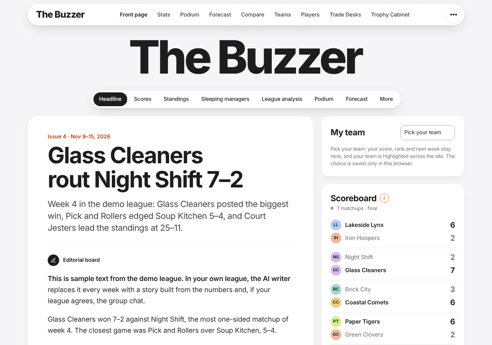

# League Newspaper

**A weekly newspaper and stats site for your fantasy basketball league.**
Every week your league gets a front page with a headline story, a scoreboard, standings, power rankings, awards, streak belts, a prediction game, player notes, trade ideas and a full archive. The numbers are calculated by the site; the stories are written by the AI of your choice.

Languages: **English · Français · Español · Türkçe** (one language per site, chosen in the settings).
Read this in: [Français](README.fr.md) · [Español](README.es.md) · [Türkçe](README.tr.md)



> **Version 0.1 supports:** Yahoo Fantasy NBA leagues, head-to-head, 9 categories (FG%, FT%, 3PT%, PTS, REB, AST, ST, BLK, TO). Other sports and scoring types are planned, see [Roadmap](#roadmap).

---

## What you get

| Page | What's on it |
|---|---|
| Front page | Headline story, scoreboard, standings, sleeping managers, awards and belts, forecast, player notes, trade desks |
| Stats | Power rankings independent of the schedule, all-play record, weekly change, heat map, your own charts, raw CSV |
| Podium | Streak belts, active streaks, sleep league ("Golden Pillow"), medal table |
| Forecast | Next week's favourites, prediction ledger, playoff odds, luck index, fair standings, reader prediction game |
| Compare | Any two teams, any week; all-time head-to-head between managers |
| Teams | One page per team: week, belts and medals, category ranks, roster with history, draft report card, trade fit |
| Players | Player and flop of the week, add/drop report, free agents, player search |
| Trade Desks | Trade ideas plus report cards of real trades |
| Trophy Cabinet | Past champions, all-time table, records |

Extras: archive of every issue, share images for each page and team, "add to home screen" app mode, optional push notification when a new issue is out, "my team" highlight (stored only in the reader's browser).

## How it works

```
Your league data (Excel)  ──►  scripts turn it into data files  ──►  the AI writes the issue  ──►  GitHub  ──►  Cloudflare builds and publishes
```

1. **Data.** Once a week, an AI with access to your league (for example ChatGPT or Claude with the Flaim connector) fills a standard Excel file. You can also fill it by hand. Format: [docs/DATA.md](docs/DATA.md).
2. **Conversion.** `scripts/excelden.py` checks the Excel and creates the week's data files.
3. **Writing.** An AI writes the headline, article, team notes and the rest, following [roles/2-WRITER.md](roles/2-WRITER.md) and your league's voice in [style/STYLE.md](style/STYLE.md).
4. **Checking.** `npm run build` validates every file and runs the tests. If something is wrong, the site is not published and the previous issue stays online.
5. **Publishing.** You commit the files to GitHub; Cloudflare rebuilds the site in about two minutes.

### One AI or several

The work is split into three **roles**, each described in a self-contained file you can paste into any AI:

| Role | File | Needs |
|---|---|---|
| Data | [roles/1-DATA.md](roles/1-DATA.md) | Access to your league (a connector such as Flaim, or you copying numbers) |
| Writer | [roles/2-WRITER.md](roles/2-WRITER.md) | The data files, your style guide, optionally the group chat export |
| Checker | [roles/3-CHECKER.md](roles/3-CHECKER.md) | The finished issue file |

- **Several AIs:** spread the cost and the waiting time, for example one AI for data and another for writing.
- **One AI:** give it the three files in order. Nothing in the template depends on a specific AI.

The site never calls an AI itself and costs nothing to run on Cloudflare's free plan.

---

## Quick start

You need: a GitHub account, a Cloudflare account (free), Node.js 22 and Python 3 with `openpyxl` on your computer (or an AI that can run code).

1. **Copy the template.** On GitHub, use "Use this template" (or fork) to create your own repository. Keep it private if your league's content is private.
2. **Set up your league** in `veri/ayarlar.json` (see [Settings](#settings)). Pick your language with `"dil"`.
3. **Remove the demo league.** Set `"ornekLig": false` in the settings (or remove the line), delete the `ornek/` folder and the files in `veri/haftalar/`, `veri/kadrolar/`, `veri/gelecek/`, `veri/nba/`, `veri/yahoo-sira/`, and empty `veri/gecmis.json`, `veri/draft.json`, `veri/fikstur.json` (or keep them until your first issue to see how they look).
4. **Write your style guide** in `style/STYLE.md`: tone, personas, what's allowed, what's off limits.
5. **Make your first issue** following [docs/WEEKLY.md](docs/WEEKLY.md).
6. **Test locally:** `npm install`, then `npm run build` and `npm run preview`.
7. **Publish on Cloudflare:** Workers & Pages → Create → Import a repository → choose your repository. Build command `npm run build`, deploy command `npx wrangler deploy`. The worker name must match `"name"` in `wrangler.jsonc`.
8. **Optional, push notifications:** run `npm run anahtar`, put the public key in `veri/ayarlar.json` → `"bildirimAnahtari"` and add the private key as the Cloudflare secret `VAPID_PRIVATE_JWK`. The KV store `ABONELER` is created automatically on the first deploy. Without the keys the site works normally, only notifications and the prediction game's online entry are off.

To try the demo first: `npm install && npm run build && npm run preview`, then open the address it prints.

---

## Settings

All in `veri/ayarlar.json`.

| Key | Example | Meaning |
|---|---|---|
| `dil` | `"en"` | Interface language: `en`, `fr`, `es`, `tr`. Addresses, file names, section anchors and helper-script messages follow it too |
| `ornekLig` | `true` | Demo league only: shows the demo issue texts in the chosen language (`ornek/<dil>.json`). Remove for your own league |
| `siteAdresi` | `"https://my-league.example.workers.dev"` | Public address of the site (used for share links) |
| `ligAdi` | `"Demo League"` | League name |
| `gazeteAdi` | `"The Buzzer"` | Newspaper name, shown as the logo |
| `gazeteAcilimi` | `["Bold", "Unbiased", …]` | Optional: words for a backronym of the name, shown small under the logo |
| `altBaslik` | `"League newspaper"` | Subtitle |
| `yayinZamani` | `"Monday 14:00"` | When a new issue comes out (text shown on the site) |
| `saatDilimi` / `saatDilimiAdi` | `"Europe/Paris"` / `"Paris time"` | Time zone for dates and for closing the prediction game |
| `elemeTakimSayisi` | `8` | Number of teams that make the playoffs |
| `normalSezonHaftaSayisi` | `19` | Weeks in the regular season |
| `elemeHaftalari` | `"weeks 20, 21 and 22"` | Playoff weeks (text) |
| `takasSonGunu` | `"2027-03-04"` | Trade deadline |
| `kemerSeridiBaslangic` | `5` | First issue that shows the belt banner |
| `elemeOlasiligiBaslangic` | `8` | First issue that shows playoff odds |
| `tahminOyunuBaslangic` | `6` | First week of the reader prediction game |
| `aktifYerler` | `{"PG":1,…,"Util":2}` | Your Yahoo active roster slots (used for the sleep score) |
| `yahooLigAdresi` | `"https://basketball.fantasysports.yahoo.com/nba/12345"` | Link to your league on Yahoo |
| `veriKaynagi` | `"Yahoo Fantasy"` | Data source credit in the footer |
| `bildirimAnahtari` | | Public push key (optional, see Quick start step 8) |
| `kocDegisimleri` | | Teams that changed manager mid-season (the sleep league restarts for them) |

> Code, data file and setting key names are in Turkish because the project started as a Turkish league's newspaper. Everything a reader sees is translated, and the weekly Excel accepts English sheet and column names too ([docs/DATA.md](docs/DATA.md)).

---

## Data, rights and privacy

- **Your data, your use.** The template has no server that collects league data. Each league pulls its own data with its own account. Yahoo's Fantasy Sports API is offered for non-commercial use; if you plan anything commercial, read Yahoo's terms first. This is not legal advice.
- **NBA box scores** for the sleep score, player of the week and trade report cards come from ESPN's public scoreboard (`scripts/nba_maclar.py`). It is unofficial and may change.
- **Group chat.** The writer can use your league's chat export for stories and the chat activity belt. Only do this if your league agrees. Only message counts per team are stored in the repository; chat content is not.
- **People.** Decide in `style/STYLE.md` how members may be named. The demo league uses invented team names.
- **Readers' choices** ("my team", dismissed prompts) stay in the reader's browser. Push subscriptions store only the subscription address and the chosen team.

Not affiliated with Yahoo, the NBA, ESPN or any AI company. Team and player names belong to their owners.

---

## Languages

The interface is written in Turkish in the code and translated through dictionaries in `src/i18n/` (`en.json`, `fr.json`, `es.json`). At build time `scripts/dil.mjs` puts the chosen language into the bundle. Numbers, percentages and dates follow the language (48.2% in English, 48,2 % in French).

**Add or fix a translation:** edit the language file; keys are the Turkish source texts. Placeholders `{0}`, `{1}` must stay; plurals use `{0|# game|# games}`; `{TAKIM}`, `{RAKIP}`, `{ESLESME}` are filled with the number of teams, opponents and weekly matchups.
**Add a language:** copy `en.json` to `xx.json`, translate it, and add the code with its locale in `scripts/dil.mjs`.

Page addresses follow the language as well (`/forecast/`, `/pronostics/`, `/pronosticos/`, `/kehanet/`), as do share-image and CSV file names, in-page section anchors and the messages of the helper scripts.

The issue text itself (headline, article, notes) is written by your AI in your league's language. The demo league ships with its sample issue in all four languages.

## Project structure

| Path | What |
|---|---|
| `veri/` | Settings and the weekly data files (one per issue) |
| `src/` | The site (Astro). Pages, components, calculations in `src/lib/`, translations in `src/i18n/` |
| `scripts/` | Converters (Excel → data files), checks, tests, push key generator |
| `worker/` | Cloudflare Worker: push subscriptions, weekly notification, prediction game entries |
| `roles/` | Instructions for the AIs (data, writer, checker) |
| `style/` | Your league's voice |
| `docs/` | Data format and weekly workflow |
| `tests/` | Tests run on every build |

## Roadmap

- Sleeper and ESPN data, points leagues and other category sets
- NFL, football (Fantasy Premier League) and Formula 1 fantasy
- English names in the code

Contributions are welcome: open an issue first for anything big.

## License

[MIT](LICENSE). Use it, change it, share it.
